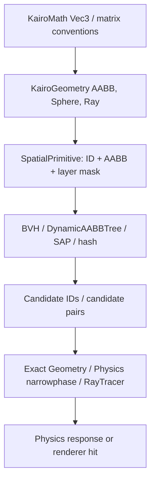

# Spatial indexing — how Kairo finds objects without testing everything

Read alongside the [linked source guide](SOURCE_READING_ORDER.md). KairoSpatial is about **efficient candidate discovery**: it generally does not prove exact physical contact, shade a pixel, or move an agent.

## 1. A geometry question becomes a search problem

KairoGeometry can answer whether a ray intersects a sphere or whether two oriented boxes overlap, but checking every possible object pair costs O(n²) in a naive collision system. An acceleration structure indexes cheaper bounds or centroids so most objects are rejected before running an expensive exact test.

[SpatialTypes.cppm](../SpatialTypes.cppm) defines consistent SpatialID, bounds, layer masks and result records. An ID is not an ownership pointer; the consuming scene/physics engine must still resolve it to a live object. Layer masks filter candidate search but do not define the object's true geometric shape.

## 2. BVH building versus traversal

[BVH.cppm](../BVH.cppm) stores nodes, primitive ordering and build settings. A parent AABB encloses descendants; leaf nodes refer to a compact range of primitives. [BVHBuilder.cppm](../BVHBuilder.cppm) recursively partitions by centroid axis, optional surface-area heuristic (SAH) or Morton ordering. Smaller leaf sizes may reduce exact-hit tests but increase tree nodes and traversal overhead; SAH improves a cost estimate rather than guaranteeing optimality.

[BVHTraversal.cppm](../BVHTraversal.cppm) prunes with ray–AABB or other volume tests and invokes a caller-provided primitive-hit callback for actual intersections. A ray tracer might put a triangle intersection in that callback. Finding an AABB hit without running the callback does not prove the ray hit a triangle inside that box. The traversal tracks visited nodes and tested primitives, useful for explaining cost.

## 3. Dynamic AABB trees, fat bounds and moving objects

[DynamicAABBTree.cppm](../DynamicAABBTree.cppm) indexes mutable bodies with proxy IDs. It expands a collider's tight bounds into a *fat AABB*, allowing small movements without immediate tree restructuring. Update avoids removal/reinsertion while the tight box fits the fat proxy. Remove/InsertLeaf maintain parent links and ancestor bounds; Validate checks consistency, while RebuildBottomUp may improve shape of a fragmented tree.

[KairoPhysicsEngine](https://github.com/swayam8624/KairoPhysicsEngine/blob/docs/teaching-walkthrough-20261121/docs/SOURCE_READING_ORDER.md) uses this logic to propose pairs. Its narrowphase still computes real contacts and the solver applies impulses. The broadphase's responsibility is **never to miss required candidates** while trying to minimize false positives.

## 4. Sweep-and-prune and uniform spatial hashing

[SweepAndPrune.cppm](../SweepAndPrune.cppm) sorts projected interval endpoints and considers objects whose intervals overlap. It can benefit from temporal coherence (small frame-to-frame changes), but nearly all-to-all overlap still causes many candidate pairs. This is why a benchmark on sparse scenes alone cannot establish superior behavior for dense cloth or particle simulations.

[SpatialHash.cppm](../SpatialHash.cppm) partitions space into fixed cells. Nearby objects often share cells, so hash lookup avoids scanning distant objects. Cell size creates a trade-off: too small requires many occupied cells for large shapes; too large creates crowded cells and false positives. A hash collision in the integer hash function also is not the same as two objects physically overlapping.

The brute-force functions in [SpatialQuery.cppm](../SpatialQuery.cppm) are useful as an independent reference to check candidate completeness in tree/hash/SAP tests.

## 5. Octree, quadtree and KDTree represent different spatial problems

[Octree.cppm](../Octree.cppm) subdivides 3D space into eight child regions, with loose bounds to accommodate objects. [Quadtree.cppm](../Quadtree.cppm) subdivides 2D rectangles—useful for terrain maps, not sufficient alone for full 3D contacts.

[KDTree.cppm](../KDTree.cppm) partitions sampled **points**, often for nearest-neighbor queries. Unlike a BVH of bounded objects, its basic entries do not describe surfaces. The correct structure depends on how frequently objects move, what kind of query is needed, and how uniformly data is distributed.

## 6. Navigation is not collision response

[NavigationGraph.cppm](../NavigationGraph.cppm) describes stable nodes and weighted edges. [AStar.cppm](../AStar.cppm) finds a low-cost path with a heuristic scaled so that cheap/zero-cost long edges do not make it overestimate; if safe scaling falls to zero, the search behaves like Dijkstra.

[NavMesh.cppm](../NavMesh.cppm) takes the next step: walkable polygons, shared-edge portals and corridor/funnel waypoints. Navigation describes *where* a character might walk. [CrowdAvoidance.cppm](../CrowdAvoidance.cppm) adjusts XZ preferred velocities among agents/obstacles, while actual locomotion, gravity, slope handling and physical collision are handled by gameplay/PhysicsEngine.

A route through a valid mesh may still be blocked by moving characters, and a safe-looking avoidance velocity may need correction by a body controller. Do not confuse these layers.

## 7. Debug and test discipline

[SpatialDebug.cppm](../SpatialDebug.cppm) exports neutral debug bounds, not a graphics device. [SpatialVisualizer.cpp](../visual/SpatialVisualizer.cpp) produces educational renderings, and [server.py](../visual/server.py) serves output on loopback; pictures illustrate queries but cannot prove correct candidate sets.

[SpatialTests.cpp](../tests/SpatialTests.cpp) compares multiple structures against brute-force reference and exercises A*, invalid graph inputs, layers and tree invariants. [ScaleStressTests.cpp](../tests/ScaleStressTests.cpp) increases deterministic scene sizes; [NavMeshTests.cpp](../tests/NavMeshTests.cpp) tests portals, path/corridor and polygon validation; [CrowdAvoidanceTests.cpp](../tests/CrowdAvoidanceTests.cpp) tests reciprocal velocity cases and input order. [CMakeLists.txt](../CMakeLists.txt) provides module targets and optional tests/visualizer.

No new compiler run or CTest execution has occurred in this teaching branch. The linked tests are evidence paths, not evidence of successful current execution.

## 8. Practical exercises

First build a tiny scene of ten overlapping/nonoverlapping AABBs and compare BVH query IDs to a brute-force scan. Then move bodies a small distance and measure how many fat-bound updates avoid tree reinsertion. Construct a path graph with zero-cost edges and show why unscaled Euclidean A* could be nonoptimal. Finally build a NavMesh corridor, record its funnel waypoints, and test how one dynamic obstacle changes the controller's local movement despite the original polygon corridor remaining valid.

For each source function, identify its **indexed representation**, **invariant**, **query contract**, **false-positive or false-negative risk**, **caller/consumer**, and **test oracle**.
